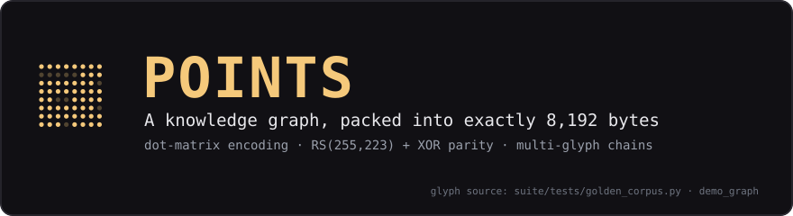

# POINTS — Persistent Ordered Information Naively Transmitted in Series

<p align="center"></p>

> Verified on the reference machine (2026-11-05):
> `python3 -m pytest suite/tests/ -q` → **94 tests passed, 42 subtests passed
> in ~1.4 s** (1.42–1.43 s across two runs today). Four historically found
> bugs (B1–B4) are protected by regression tests that fail if the bug returns.

**POINTS** is a visual knowledge-graph codec. It packs a whole knowledge
graph — entities, typed and tagged edges, facets, salience, epistemic
state — into a **block of exactly 8,192 bytes** (a *glyph*), which is a
65,536-bit dot matrix: readable by eye, camera, or software. Glyphs are
self-contained, and the format supports multi-glyph chaining, so graphs
larger than one block span a numbered sequence.

Why it is interesting:

- **Fixed size.** The byte budget is a hard constraint, not a heuristic.
- **Damage repair.** Reed–Solomon parity (255,223) corrects up to 16
  damaged symbols per 223-byte block; XOR parity is the cheaper
  detect-only mode. The header says which mode a glyph uses.
- **Human-checkable.** A glyph *is* a dot matrix — the deterministic
  raster of the golden demo glyph is committed at
  `assets/sample_glyph.png` (one dot per bit; regenerate with
  `python3 tools/render_glyph_assets.py`).
- **Epistemic structure is first-class.** Every connection carries its
  own confidence and polarity fields, not `null`s.
- **Agent-transportable.** Agents pass a glyph as a single U+E000
  session key or as raw bytes; the MCP server (`suite/points_mcp.py`)
  exposes encode/decode to agent harnesses — a live encode→decode
  round-trip through it was verified on 2026-11-05 (`parity_ok: true`).
- **Measured.** On the reference sweep, at 460 entities in one glyph
  POINTS holds **9.7×** the semantic capacity of compact JSON for the
  same facts. See the ONE paper for the full measurements.

## Repository layout

| Path | Role |
|---|---|
| `suite/glyph.py`, `suite/glyph_multi.py` | Glyph pack/unpack; single- and multi-glyph manifest protocol |
| `suite/header.py`, `suite/structure.py` | Fixed 42-byte header layout; graph data model (Entity, Edge, Graph, LiteralValue) |
| `suite/bits.py` | Raw bit packing (9→8 expansion, chunked) |
| `suite/encode_entities.py`, `suite/encode_edges.py`, `suite/encode_payload.py` | Entity, edge, and payload encoders |
| `suite/parity.py`, `suite/rs_codec.py` | XOR/RS parity orchestration; Reed–Solomon (255,223) codec over GF(256) |
| `suite/points_tool.py`, `suite/agent_tool.py`, `suite/points_mcp.py` | Integration surfaces: session-key transport, agent functions, MCP server |
| `suite/delegation.py` | Label-convention task/result transport for sub-agents |
| `suite/demo.py` | Demo pipeline: build a small graph, pack it, verify the round-trip |
| `suite/tests/test_*.py` | 94 tests + 42 subtests: pipeline, red team, codec gaps (B1–B4), multi-glyph, delegation, agent glyphs |
| `suite/tests/golden_corpus.py` | 7 reference glyphs: empty graph → single entity → edges → payload → negated → the 11-entity "mechanical watch" |
| `suite/tests/bench_glyph.py` | Glyph performance benchmarks |
| `showcase/` | Runnable sub-agent showcases: `run_showcase.py`, shared base + 4 profiles (beam, code, logic, math), task YAMLs |
| `beam_search.py` | Standalone beam search used during development (no POINTS dependency) |
| `tools/` | Committed asset generator (`render_glyph_assets.py`) |
| `assets/` | Generated documentation assets (banner, golden-glyph raster) |
| `point1.md`, `point2.md`, `anchor.md` | The structural theory ("Point 1"), the dot-matrix mapping framework ("Point 2"), and the anchored project summary |
| `prior/` | Superseded drafts of the theory documents (kept for provenance) |

## Quick start

```bash
python3 -m pytest suite/tests/ -q                  # 94 tests + 42 subtests
python3 -m pytest suite/tests/test_redteam.py -q   # damage-pattern suite (28 tests today)
python3 suite/demo.py                              # graph → glyph → verified round-trip
python3 tools/render_glyph_assets.py               # regenerate assets/ deterministically
```

Every command above was executed on the reference machine on
2026-11-05; expected outcomes are stated in the verification note at the
top of this file and in `anchor.md`.

## Glyph byte layout (summary)

Each glyph is exactly 8,192 bytes:

1. **Fixed header (42 bytes)** — magic, version, sequence number, parity
   mode/count, entity/edge counts, graph id, region offsets, trailing
   CRC16 over the first 40 bytes.
2. **Entity table** — each entity: id code, label index, properties.
3. **Edge table** — per edge: source/target, relation code (one of 5
   relation types — equivalence, IS-A, instance-of, part-of, associative),
   meronymy subtype where applicable, confidence tag (0..3), polarity
   (affirmed/denied), optional reification.
4. **Payload regions** — literal properties, facet and salience lists.
5. **Parity** — either XOR (≈15 % of content, detect-only) or RS(255,223)
   blocks (32 parity bytes per block, corrects up to 16 bad symbols each).

The bits then *are* the dots: laid out row-major, MSB-first, they form
the 65,536-dot rendering surface described in `point2.md`.

The full formal grammar is Appendix "Full O-OIS EBNF Grammar" of the ONE
paper; the structural theory behind the layout is `point1.md` and
`point2.md` in this repository.

## Relationship to the ONE paper

POINTS is one of the three instantiations of the O-OIS grammar studied in
"Maximum Semantic Capacity via the Ontology of Optimal Information
Structure" (2026). The golden corpus here — an empty graph, a single
entity, a single edge, a 4-entity multi-edge graph, a payload graph, a
denied/uncertain graph, and the 11-entity "mechanical watch" — is the
reference set used by the paper's Table on semantic capacity. The demo
graph itself (`suite/demo.py`) carries 11 entities and 14 edges, as
printed by the demo run recorded on 2026-11-05.

See also the sibling repositories: **65536** (the human-facing symbol
font and hierarchy codec) and **MSCA** (the tiered agent-memory archive
the grammar drives).

## License

MIT — see [`LICENSE`](LICENSE).
